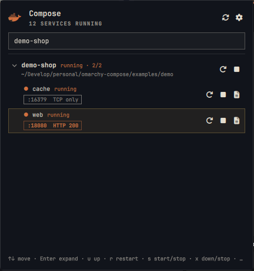

# Omapose

Docker Compose projects in the Omarchy bar. See every project and service at a glance, bring them up or down, restart or stop single services, check whether their ports answer HTTP, and follow logs — from a panel, without opening a separate app.



## Install

```sh
omarchy plugin add https://github.com/JeanpiDev/omapose.git --enable
```

### Requirements

| Dependency | Used for |
|---|---|
| Omarchy Quattro | the shell, bar and theme |
| `docker` + `docker compose` v2 | listing, actions and logs |
| your user in the `docker` group ([Docker post-install steps](https://docs.docker.com/engine/install/linux-postinstall/)) | talking to the daemon as your user |
| `curl` | optional HTTP check of published ports |
| `wl-copy` (wl-clipboard) | copying a port address |
| `xdg-open` | opening a port in the browser |
| `xdg-terminal-exec` | following logs in your terminal |

All of them ship with Omarchy except Docker itself.

**Engine pinning.** Every Docker command targets the endpoint of the context the list was read from, and actions re-check the engine ID right before running. Switching `docker context` while a confirmation is open cannot redirect it to another engine.

**Privileges.** The plugin never asks for elevated rights. It runs `docker` as your user, so it can do whatever your user can do with Docker; keep in mind that membership of the `docker` group gives full control of the machine. Actions that remove containers (`Down`) always ask first.

## Usage

Click the whale in the bar (right click refreshes). The number next to it is how many services are running.

| Key | Action |
|---|---|
| Tab / Shift+Tab | Next / previous bar panel (Omarchy convention) |
| `/` | Search · ↓ from the search goes to the list |
| ↑ ↓ / j k | Move |
| Enter / → | Expand a project · open a service's logs |
| ← | Collapse · back to the project |
| `u` | Up (project) |
| `r` | Restart (project or service) |
| `s` | Start / stop a service |
| `x` / Delete | Down a project (asks first) · stop a service |
| `e` | Open a shell inside the service's container (bash, or sh when bash is missing) |
| `o` / `y` | Open / copy the first port of a service |
| `f` | Forget a remembered project with no containers (also `quickshell ipc -p /usr/share/omarchy/shell call io.github.jeanpidev.omapose forget <name>`) |
| `,` | Settings and About |
| `R` | Refresh |
| Esc | Back · close |

Service actions act on the container, so they also work for services behind compose `profiles:` and for containers whose service was removed from the file. Bringing a project down includes every profile and removes those orphan containers.

Each running service shows its own RAM next to its state. The header shows how many containers are running, Docker's CPU as a share of the whole machine, and its RAM (used, % and total), sampled with `docker stats` every 10 s while the panel is open.

Ports show whether they answer: `HTTP 200`, `HTTP 404 · API`, `HTTP 401 · auth`, `TCP only` (databases), `No response`. Only HTTP ports open in the browser.

Projects you brought down stay in the list (remembered in `~/.local/state/omarchy/omapose/projects.json`) so you can bring them up again.

## Configure

Panel → gear, or `omarchy bar set io.github.jeanpidev.omapose <key> <value> --json`:

| Key | Default | |
|---|---|---|
| `probePorts` | `true` | Check whether ports answer HTTP (one request per port when the panel opens, then every 60 s while it is open — it shows up in the service's access log) |
| `showStopped` | `true` | List projects with nothing running |
| `logLines` | `200` | Lines kept in the log view |
| `idleRefreshSec` | `60` | Fallback refresh; changes arrive instantly through `docker events` |
| `language` | `auto` | `auto` follows Omarchy's language; `en` or `es` force one |

Move it in the bar like any widget:

```sh
omarchy bar move io.github.jeanpidev.omapose --section right
```

## Works with

- The native Omarchy bar and the Shibumi bar (icon follows the bar's widget colour).
- Any theme: every colour comes from the theme and updates live.
- English and Spanish (follows Omarchy, or pick one in Settings).

## Privacy

Only talks to the local Docker daemon and to `127.0.0.1` ports for the optional HTTP check. Nothing leaves this computer.

## Known limitations

- After `omarchy plugin disable` + `enable` without restarting, the shell may not remount bar widgets correctly; run `omarchy restart shell`.
- A service stopped by hand and a one-shot init container that finished look the same to Docker, so a project with either shows `partly running · n/m`.

## Develop

```sh
node --test tests/
scripts/dev-sync.sh          # copy into ~/.config/omarchy/plugins and restart the shell
examples/demo/               # small nginx + redis project to try it with
```

## Remove

```sh
omarchy plugin remove io.github.jeanpidev.omapose
rm -rf ~/.local/state/omarchy/omapose   # optional: remembered projects
```

## License

MIT
